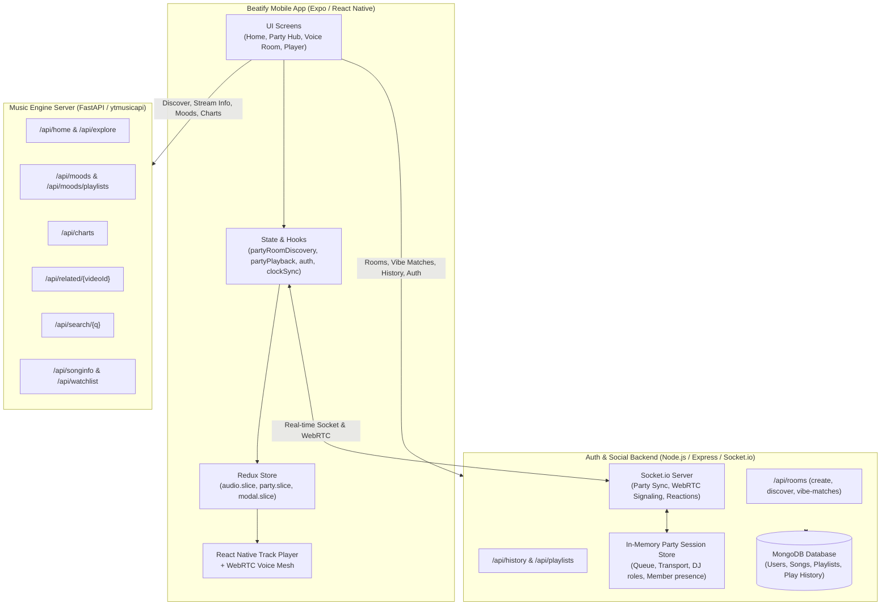

# Beatify: Collaborative Gamified Music & Party Platform
## Architecture & Code Structure Guide

> **Target Audience**: Human developers, AI pair-programming agents, and system architects.
> **Scope**: Covers all three codebases powering the Beatify ecosystem:
> 1. **Client**: `c:\Users\ankit\Documents\Projects\beatify` (Expo / React Native)
> 2. **Music Engine**: `C:\Users\ankit\Documents\Projects\MusicPlayer\Server` (Python FastAPI + ytmusicapi)
> 3. **Social & Auth Backend**: `C:\Users\ankit\Documents\Projects\MusicPlayer\auth_backend` (Node.js Express + Clerk + Socket.io + MongoDB)

---

## 1. High-Level System Architecture

---

## 2. Codebase Map & Directory Structure

### A. Mobile Client (`beatify`)
- **`app/`**: Expo Router navigation tree
  - `(tabs)/`: Main tab navigation
    - `homeRoutes/Home.jsx`: Interactive, vibrant home screen with dynamic mood & genre pills, live party banner, trending charts, quick picks, and recommendations.
    - `homeRoutes/Album.jsx`: Album & playlist track listing view.
    - `party/index.js`: Collaborative Gamified Party Hub (Level/XP vibe banner, Create Room modal, Join by Code, Live active rooms feed, Vibe matchmakers, Gamification badges).
    - `search.js`: Music search screen with auto-suggestions.
    - `library.tsx`: Saved playlists and listening history.
  - `album.jsx`: Root stack screen for album & playlist details, preserving the exact caller back-stack whether opened from Home, Search, or Library.
  - `artist.jsx`: Root stack screen for artist profile, top tracks, albums, singles, related artists, and bio.
  - `voiceRoom/`: Shared party listening & voice room
    - `_layout.jsx`: Fullscreen party view with header, now-playing card, participant strip, and stage.
    - `DJPanel.jsx`: DJ controls (queue reorder, request inbox, transfer DJ).
    - `PartyTransport.jsx`: Synchronized playback controls (play/pause/seek/rekey).
    - `PartyQueue.jsx`: Room queue & user song request submission.
    - `chat.jsx`: Real-time room text chat.
    - `webRTC.jsx`: Mesh WebRTC voice chat signaling and audio tracks.
  - `player/`: Personal audio player sheet (slider, lyrics, queue).
- **`services/`**: API interaction services
  - `explore.service.js`: Interfaces with Python music server (`getHome`, `getMoodCategories`, `getMoodPlaylists` with deduplication and cap, `getExplore`, `getCharts`, `getRelated`).
  - `artist.service.js`: Interfaces with Python music server (`getArtist`, `getArtistAlbums`).
  - `room.service.js`: Interfaces with auth/party backend (`createPartyRoom`, `getActiveRooms`, `getDiscoverRooms`, `getVibeMatches`, `getRoomById`).
  - `album.service.js`: Album & playlist details.
  - `track.service.js`: Song metadata and direct audio stream resolution.
  - `party.service.js`: Room playback synchronization and TrackPlayer bridging.
- **`hooks/`**: Custom application hooks
  - `partyRoomDiscovery.hooks.js`: Room creation, room discovery, vibe matching, and real-time room update events.
  - `partyPlayback.hooks.js` & `partyEvents.hooks.js`: WebSockets clock synchronization and shared listening transport.
  - `partyPresence.hooks.js`: Ephemeral reactions, mic mute, and raised hand state.
  - `auth.hooks.js`: Clerk authentication integration and authenticated axios instance (`useClerkAxios`).
- **`state/`**: Redux state slices
  - `slices/party.slice.js`: Party room state (roomId, title, vibe, tags, queue, role, status, sync offsets, participants, chat).
  - `slices/audio.slice.js`: Personal player state (current track, playback status, duration, position).
- **`configs/`**:
  - `apiClient.config.js`: Axios instance pointing to Python music server.
  - `socket.js`: Socket.io client pointing to auth/social backend with token refresh.
  - `ytClients.config.js`: InnerTube client headers for direct streaming.

---

### B. Music Engine Server (`MusicPlayer/Server`)
- **FastAPI Framework** with `ytmusicapi` for YouTube Music services (discovery, moods, playlists, charts, related tracks).
- **`api/home.py`**:
  - `GET /api/home`: Standard homepage recommendations.
  - `GET /api/moods`: Mood & Genre category taxonomy (`Moods & moments`, `Genres`).
  - `GET /api/moods/playlists?params={params}`: Playlists for a chosen mood or genre.
  - `GET /api/explore`: Explore feed (new releases, trending, top episodes).
  - `GET /api/charts?country=IN`: Top trending music videos and artists.
  - `GET /api/related/{videoId}`: Song watch playlist + related items ("You might also like", "Similar artists", "Recommended playlists").
- **`api/search.py`**:
  - `GET /api/search/{q}?filter={songs|albums|playlists|artists}`: Search with filter support.
  - `GET /api/searchSuggestions/{q}`: Detailed autocompletion queries.
- **`api/songs.py`**:
  - `GET /api/songinfo/{id}`: Video player info.
  - `GET /api/watchlist/{videoId}`: Song watch playlist.

---

### C. Auth & Social Backend (`MusicPlayer/auth_backend`)
- **Node.js + Express + Socket.io + Clerk + MongoDB**.
- **`controllers/room.controller.js`**:
  - `createRoom`: Create a room with custom ID or generated 4-digit code, title, vibe, tags, and host.
  - `getRooms`: List active rooms filtered by vibe or search query.
  - `getDiscoverRooms`: Grouped discover feed with curated starter stations.
  - `getVibeMatches`: Vibe matching algorithm based on user's listening history in MongoDB.
  - `getRoomById`: Fetch room state by roomId.
- **`sockets/party/`**:
  - `store.js`: In-memory room session store with queue, DJ roles, status, and search index.
  - `members.js`: Handles `party:hello`, `party:create-room`, `party:list-rooms`, and member leave/handoff.
  - `social.js`: `party:reaction` broadcasts floating emojis and presence badges.
  - `transport.js` / `transport2.js` / `transport3.js`: Synchronized playback events (`dj:load`, `dj:play-at`, `dj:pause-at`, `dj:seek-at`, `dj:next`, `dj:prev`).
  - `clock.js`: NTP-style clock synchronization (`clock:ping` -> `clock:pong`).
  - `requests.js`: Audience song request inbox and DJ approval queue.

---

## 3. Collaborative Party Protocol & Sync Model

1. **Host or Join**:
   - Creating a room creates an in-memory session in `store.js`.
   - Joining a room joins the Socket.io room and emits `party:hello`.
2. **Clock Synchronization (NTP-style)**:
   - Client and server exchange timestamps via `clock:ping`/`clock:pong`.
   - Round-trip time (RTT) and one-way network offset are calculated with exponential moving average.
3. **Scheduled Playback (`playAtServerMs`)**:
   - When the DJ hits play or skips a track, the server schedules playback at `Date.now() + BUFFER_MS` (typically 300-500ms in the future).
   - All connected listener clients schedule playback to start at that exact server timestamp, ensuring millisecond-accurate synchronized listening across different devices.
4. **Voice Chat (WebRTC Mesh)**:
   - Voice channels run in parallel using WebRTC audio-only peer connections.
   - Signaling (offer, answer, ICE candidates) is relayed through `sockets/room.js`.
5. **Gamification & Social Presence**:
   - Members send ephemeral reactions (`🔥`, `🎉`, `❤️`, `⚡`) that burst onto other members' screens.
   - Users earn Party XP and listening streak badges for participating and DJing.

---

## 4. Algorithmic Vibe Matching & Zero-Cost Architecture

Beatify implements a production-grade algorithmic music matchmaking and room discovery engine built without expensive vector databases or third-party ML APIs (zero operating cost).

### A. Mathematical Formulation

1. **Exponential Recency Decay**:
   User music taste evolves over time. When extracting user vectors from MongoDB `History`, each play $p_i$ is weighted with a half-life of 14 days:
   $$w_i = \exp\left(-\frac{\ln(2)}{14} \cdot \Delta t_i\right)$$
   where $\Delta t_i$ is elapsed days since the play.

2. **Taste Vector Construction**:
   - **Artist Vector ($\vec{A}$)**: Formed by aggregating time-decayed weights of song authors.
   - **Genre/Keyword Vector ($\vec{G}$)**: Normalized and canonicalized from raw song `keywords` into standard vibes (Lo-Fi, Synthwave, Bollywood, EDM, Focus, Energize, Romance, Hip-Hop, Pop, Rock, Indie).
   - **Time Slot Vector ($\vec{T}$)**: Partitions plays into Night (22-04), Morning (05-11), Afternoon (12-16), and Evening (17-21).

3. **Pairwise Vibe Twin Similarity**:
   For any two users $u_1$ and $u_2$, their compatibility score is computed using multidimensional Cosine Similarity:
   $$\text{sim}_{\text{artist}} = \frac{\vec{A}_1 \cdot \vec{A}_2}{\|\vec{A}_1\| \|\vec{A}_2\|}, \quad \text{sim}_{\text{genre}} = \frac{\vec{G}_1 \cdot \vec{G}_2}{\|\vec{G}_1\| \|\vec{G}_2\|}, \quad \text{sim}_{\text{time}} = \frac{\vec{T}_1 \cdot \vec{T}_2}{\|\vec{T}_1\| \|\vec{T}_2\|}$$
   Composite match percentage:
   $$\text{Match}\% = \text{clamp}\left(\left(0.55 \cdot \text{sim}_{\text{artist}} + 0.35 \cdot \text{sim}_{\text{genre}} + 0.10 \cdot \text{sim}_{\text{time}} + \text{sharedBonus}\right) \times 100, 58, 98\right)$$

4. **Algorithmic Room Scoring**:
   Rooms are ranked dynamically for the authenticated listener using taste affinity:
   $$\text{Score}(u, R) = w_{\text{vibe}} \cdot \mathbb{I}(\text{vibe} \in \vec{G}_u) + w_{\text{tags}} \cdot |\text{tags} \cap \vec{G}_u| + w_{\text{artist}} \cdot \mathbb{I}(\text{nowPlayingArtist} \in \vec{A}_u) + \min(20, \text{listeners} \times 3)$$

5. **Gamification & Level Curve**:
   - $\text{XP} = (\text{plays} \times 10) + (\text{uniqueArtists} \times 25) + (\text{streak} \times 50) + (\text{roomsCreated} \times 40) + (\text{roomsJoined} \times 15) + (\text{reactions} \times 5)$
   - $\text{Level} = \max\left(1, \lfloor \sqrt{\text{XP} / 80} \rfloor + 1\right)$
   - $\text{nextLevelXP} = \text{Level}^2 \times 80$
   - Badges (`first_drop`, `crate_digger`, `sound_voyager`, `streak_master`, `night_owl`, `party_starter`, `aux_champ`) unlocked strictly by real historical milestones.

### B. Storage & Performance Optimization
- **`UserProfile` MongoDB Model (`models/profile.model.js`)**: Caches computed vectors and gamification metrics with 10-minute invalidation TTL. Avoids expensive N+1 recomputation on every request.
- **Dynamic Anchor Station Auto-Hydration**: When users join an algorithmic community station, it automatically instantiates as an active collaborative session in `store.js` with verified playable YouTube videoIds.

